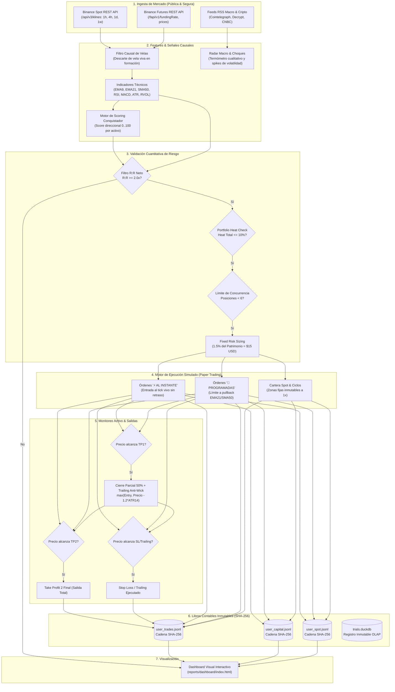

# QUANT-ARENA v2 — Laboratorio Cuantitativo & Agente Autónomo Conquistador (M6.3)

[](https://www.python.org/downloads/)
[](http://mypy-lang.org/)
[](https://github.com/astral-sh/ruff)
[](https://docs.pytest.org/)
[](https://duckdb.org/)
[-success.svg)]()
[]()

---

## 1. Resumen Ejecutivo

**QUANT-ARENA v2** es un entorno integrado de computación cuantitativa, ingeniería de datos financieros y operativa algorítmica autónoma en criptoactivos, diseñado bajo los estándares más exigentes de la literatura econométrica moderna (*Marcos López de Prado, David Bailey, Peter Hansen, Halbert White*).

El sistema opera bajo una doble arquitectura sinérgica:

1. **Laboratorio de Investigación y Verificación Empírica (M0 – M5)**: Plataforma determinista para el diseño, contraste y validación estadística de hipótesis sistemáticas de baja frecuencia (H1: *Trend Following con Volatility Targeting*, H2: *Cross-Sectional Momentum en universo Point-in-Time*, H3: *Cash-and-Carry Spot-Perpetual Delta-Neutral*). Implementa control estricto de tasas de falso descubrimiento (FWER / FDR), validación cruzada combinatoria purgada con embargo (**CPCV**), prueba de sobreajuste de backtests (**CSCV / PBO**), **Deflated Sharpe Ratio (DSR)**, **Reality Check de White** y **Superior Predictive Ability (SPA) de Hansen** sobre un dataset con holdout sellado criptográficamente con anclaje en blockchain mediante **OpenTimestamps (OTS)**.
2. **Agente Autónomo de Ejecución "Conquistador" (M6.3)**: Motor algorítmico continuo de **Paper Trading** de alta fidelidad sobre una cartera simulada de referencia de **$1,000 USD**. Analiza en tiempo real un universo de los 10 activos de mayor liquidez de Binance en marcos temporales múltiples (**1H, 4H, 1D, 1W**), evaluando indicadores técnicos causales normalizados, gestionando posiciones abiertas con disciplina geométrica neta ($R:R \ge 2.0\text{x}$ a $2.8\text{x}$), ejecutando entradas inmediatas a mercado y órdenes límite en retroceso técnico (*pullback*), aplicando *trailing stops* a *Break-Even* al alcanzar objetivos parciales (TP1) y auditando cada evento en libros contables inmutables (*append-only ledger*) encadenados mediante funciones de hash **SHA-256**.

### Características Operativas Clave

* **Exchanges Compatibles**: **Binance Spot** y **Binance USDⓈ-M Futures** (conectividad mediante *endpoints* públicos de lectura con presupuestos de peso estricto por minuto y *exponential backoff*).
* **Tipos de Operativa**: 
  * *Futuros USD-M*: Intradía (1H), Táctico (4H) y Swing Tendencial (1D), con apalancamientos moderados (3x a 5x) tanto en largo (*LONG*) como en corto (*SHORT*).
  * *Cartera Spot & Ciclos*: Acumulación no apalancada (1x) en marcos 4H, 1D y 1W con Zonas de Compra Inmutables a Precio Razonable y Zonas de Toma de Ganancias dinámicas al alza.
  * *Arbitraje de Funding*: Captura de carry delta-neutral en pares spot-perp.
* **Seguridad Estructural por Construcción**: El código fuente cuenta con guardias AST automatizadas (`test_safety_no_trading_clients.py`) que **prohíben por diseño el uso de claves privadas de exchange, conexiones con dinero real y sockets de escucha externa**. Toda la operativa se ejecuta en simulación estricta con comisiones *taker/maker* verificadas y modelos de impacto de liquidez (*slippage*).

---

## 2. Fundamentos Científicos y Financieros (Ciencia Detrás del Bot)

### 2.1. Lógica Cuantitativa e Ineficiencias de Mercado Explotadas

El mercado de criptomonedas exhibe anomalías estadísticas pronunciadas derivadas de la fragmentación de liquidez, la participación asimétrica de inversores minoristas y la mecánica de apalancamiento en contratos de swap perpetuo. QUANT-ARENA v2 explota tres alfas pre-registrados y una regla de selección multi-factorial:

```
                                      ┌─────────────────────────────────────────────────────────┐
                                      │              UNIVERSO QUANT-ARENA (10 Activos)          │
                                      │  BTC, ETH, SOL, BNB, XRP, ZEC, NEAR, SUI, UNI, DOGE    │
                                      └────────────────────────────┬────────────────────────────┘
                                                                   │
                                  ┌────────────────────────────────┼────────────────────────────────┐
                                  ▼                                ▼                                ▼
                   ┌──────────────────────────────┐ ┌──────────────────────────────┐ ┌──────────────────────────────┐
                   │    H1: Trend Following       │ │   H2: Cross-Sectional Mom    │ │    H3: Carry Delta-Neutral   │
                   │    Time-Series Momentum      │ │    Point-in-Time Universe    │ │    Spot-Perp Basis Arbitrage │
                   └──────────────┬───────────────┘ └──────────────┬───────────────┘ └──────────────┬───────────────┘
                                  │                                │                                │
                                  └────────────────────────────────┼────────────────────────────────┘
                                                                   ▼
                                      ┌─────────────────────────────────────────────────────────┐
                                      │        MOTOR AUTÓNOMO M6.3: "CONQUISTADOR" (Multi-TF)   │
                                      │   Scoring Multi-Factorial (0..100) en 1H, 4H, 1D, 1W    │
                                      │        EMA Alignment + MACD + RSI + RVOL Filter         │
                                      └────────────────────────────┬────────────────────────────┘
                                                                   │
                                                                   ▼
                                      ┌─────────────────────────────────────────────────────────┐
                                      │      FILTRO GEOMÉTRICO NETO & CONTROL DE RIESGO         │
                                      │   R:R Neto >= 2.0x (descontando comisiones round-trip)  │
                                      │   Risk Sizing: 1.5% Equity ($15 USD) | Heat <= 10%      │
                                      └─────────────────────────────────────────────────────────┘
```

1. **Persistencia Tendencial de Serie Temporal (H1 - Time-Series Momentum)**: Explotación del sesgo de sub-reacción inicial de los participantes ante flujos de capital institucionales sostenidos. Se evalúan reglas $Close_t > SMA_n(Close)_t$ y retornos acumulados de $L$ días con dimensionamiento dinámico inverso a la volatilidad realizada.
2. **Momentum Transversal en Universo Point-in-Time (H2 - Cross-Sectional Momentum)**: Long del tercil superior de activos líderes ordenados por su retorno de formación semanal $f[w] = \frac{Close_{w-2}}{Close_{w-2-L}} - 1$, excluyendo estrictamente la última semana cerrada para neutralizar la reversión a la media de corto plazo provocada por fricciones de microestructura (*bid-ask bounce*). Reconstruido en universo Point-in-Time (PIT) libre de sesgo de supervivencia.
3. **Arbitraje de Tasa de Financiamiento (H3 - Cash and Carry Delta-Neutral)**: Extracción sistemática de la prima de liquidez exigida por los especuladores alcistas en los futuros perpetuos. Consiste en la compra spot simultánea a la venta corta del contrato perpetuo cuando la media móvil de la tasa de financiamiento anualizada supera el umbral pre-registrado ($5\%$ o $10\%$), capturando el flujo de pagos cada 8 horas sin riesgo direccional de precio.
4. **Motor Multi-Factorial de Alta Convicción (M6.3 - Conquistador)**: Algoritmo de scoring aditivo (0 a 100 puntos) que sintetiza la estructura de tendencia, aceleración de momentum y confirmación volumétrica para desplegar operaciones directas o programadas.

### 2.2. Modelos Matemáticos e Indicadores Técnicos Causales

Todos los cálculos del sistema satisfacen el **principio de causalidad temporal estricta**: ninguna variable en el instante $t$ tiene acceso a información de $t+k$ ($k > 0$). Todos los indicadores superan pruebas automatizadas de invarianza por truncamiento:

$$f(x_{0:t})_t = f(x)_t, \quad \forall t$$

#### Medias Móviles y Tendencia
* **Media Móvil Simple ($SMA_n$)**:
  $$SMA_n(P)_t = \frac{1}{n} \sum_{i=0}^{n-1} P_{t-i}$$
* **Media Móvil Exponencial ($EMA_k$)**:
  $$EMA_k(P)_t = \alpha P_t + (1 - \alpha) EMA_k(P)_{t-1}, \quad \text{donde } \alpha = \frac{2}{k + 1}$$
  El sistema utiliza la alineación de $EMA_9$ y $EMA_{21}$ para determinar la inercia del precio en marcos de 1H y 4H, complementada con el filtro de largo plazo $Close > SMA_{50}$ en marco diario (1D).

#### Momentum y Aceleración
* **RSI de Wilder ($RSI_{14}$)**:
  $$RS_t = \frac{\overline{Gain}_{14, t}}{\overline{Loss}_{14, t} + \epsilon}, \quad RSI_{14, t} = 100 - \frac{100}{1 + RS_t}$$
  Donde las ganancias y pérdidas promedio se suavizan causalmente con ventana móvil de 14 períodos.
* **MACD (Moving Average Convergence Divergence - 12, 26, 9)**:
  $$MACD_{line, t} = EMA_{12}(P)_t - EMA_{26}(P)_t$$
  $$Signal_{line, t} = EMA_9(MACD_{line})_t$$
  $$MACD_{hist, t} = MACD_{line, t} - Signal_{line, t}$$
  La pendiente y el signo del histograma ($MACD_{hist}$) asignan hasta 25 puntos en la evaluación direccional.

#### Volatilidad y Microestructura
* **True Range ($TR$) y Average True Range ($ATR_{14}$)**:
  $$TR_t = \max \Big( High_t - Low_t, \, |High_t - Close_{t-1}|, \, |Low_t - Close_{t-1}| \Big)$$
  $$ATR_{14, t} = \frac{1}{14} \sum_{i=0}^{13} TR_{t-i}$$
* **Volumen Relativo ($RVOL_{20}$)**:
  $$RVOL_t = \frac{Volume_t}{\frac{1}{20} \sum_{i=1}^{20} Volume_{t-i} + \epsilon}$$
  Filtra rupturas en falso exigiendo $RVOL \ge 1.0\text{x}$ para otorgar máxima ponderación.

#### Modelo de Scoring del Agente "Conquistador"

El sistema evalúa cada par cripto a través de una función de puntuación que calibra la dirección dominante ($LONG$ vs $SHORT$):

$$\text{Score} = \min \Big(100, \, S_{\text{EMAs}} + S_{\text{MACD}} + S_{\text{RSI}} + S_{\text{RVOL}} \Big)$$

| Componente | Criterio Matemático Evaluado | Puntos Asignados |
| :--- | :--- | :--- |
| **Alineación de Medias** | $EMA_9 > EMA_{21}$ (en marco de trabajo) | +20 pts |
| **Régimen Macro (1D)** | $Close_{1D} > SMA_{50}(1D)$ | +10 pts |
| **Aceleración MACD** | $MACD_{hist} > 0$ (alcista) ó $< 0$ (bajista) | +25 pts |
| **Rango de Inercia RSI** | $50 \le RSI_{14} \le 72$ (momentum) ó $RSI < 35$ (rebote) | +20 a +25 pts |
| **Confirmación de Volumen** | $RVOL_{20} \ge 1.0\text{x}$ | +20 pts (base +10 pts) |

---

### 2.3. Gestión Cuantitativa del Riesgo (Risk Management)

La preservación del capital domina cualquier hipótesis de rentabilidad. El sistema incorpora un marco de gestión de riesgos en capas:

#### 1. Dimensionamiento Dinámico Adaptativo (Half-Kelly / Volatility Targeting)
Cada operación modula su fracción de riesgo de capital en función del score de convicción y el régimen de volatilidad relativa respecto a su media histórica, acotado entre un mínimo de 0.75% y un máximo de 2.50%:

$$\text{Risk\%} = \text{clip}\left(0.015 \times \left(\frac{\text{Score}}{70}\right) \times \left(\frac{\overline{ATR}_{80}}{ATR_{14, t}}\right), \, 0.0075, \, 0.025\right)$$

$$\text{Riesgo}_{\text{USD}} = \text{Patrimonio Total} \times \text{Risk\%}$$

$$\text{Distancia al SL (\%)} = \frac{|\text{Precio Entrada} - \text{Stop Loss}|}{\text{Precio Entrada}}$$

$$\text{Tamaño Posición (Nocional USD)} = \frac{\text{Riesgo}_{\text{USD}}}{\max\big(0.005, \, \text{Distancia al SL (\%)}\big)}$$

$$\text{Margen Requerido (USD)} = \frac{\text{Tamaño Posición (USD)}}{\text{Apalancamiento}}$$

#### 2. Parámetros Geométricos Asimétricos basados en ATR
Los niveles de salida son calculados dinámicamente mediante la volatilidad intrínseca del activo:

$$\text{dist\_sl} = \max\Big(1.5 \times ATR_{14}, \, 0.015 \times \text{Entry}\Big)$$

Para posiciones largas (*LONG*):
* $\text{Stop Loss (SL)} = \text{Entry} - \text{dist\_sl}$
* $\text{Take Profit 1 (TP1)} = \text{Entry} + 1.6 \times \text{dist\_sl}$
* $\text{Take Profit 2 (TP2)} = \text{Entry} + 2.8 \times \text{dist\_sl}$

Para posiciones cortas (*SHORT*):
* $\text{Stop Loss (SL)} = \text{Entry} + \text{dist\_sl}$
* $\text{Take Profit 1 (TP1)} = \text{Entry} - 1.6 \times \text{dist\_sl}$
* $\text{Take Profit 2 (TP2)} = \text{Entry} - 2.8 \times \text{dist\_sl}$

#### 3. Cierre Parcial del 50% en TP1 y Trailing Stop Protector Anti-Wick
Al alcanzar TP1 ($1.6 \times dist\_sl$), el motor ejecuta:
1. **Liquidación Parcial del 50%**: Se cierra la mitad del nocional, acreditando inmediatamente el PnL neto realizado en el ledger y reduciendo a la mitad el capital expuesto.
2. **Trailing Stop Protector Anti-Wick**: El Stop Loss se eleva como mínimo al precio de entrada (*Break-Even*), y a medida que el precio avanza hacia TP2, el Stop Loss sigue al mercado a una distancia prudencial:
   $$\text{Trailing SL (LONG)} = \max\Big(SL_{\text{actual}}, \, \text{Entry}, \, \text{Precio Actual} - 1.2 \times ATR_{14}\Big)$$
   $$\text{Trailing SL (SHORT)} = \min\Big(SL_{\text{actual}}, \, \text{Entry}, \, \text{Precio Actual} + 1.2 \times ATR_{14}\Big)$$
   Evitando liquidaciones prematuras provocadas por mechas de volatilidad intradía (*wicks*).

#### 3. Filtro de Ratio Riesgo-Beneficio Neto ($R:R_{\text{neto}} \ge 2.0\text{x}$)
Ninguna orden es aceptada si su ratio riesgo:beneficio deducidas comisiones es inferior al umbral mínimo fijado:

$$R:R_{\text{neto}} = \frac{|\text{TP}_2 - \text{Entry}| - \text{Fees}_{\text{roundtrip}}}{|\text{Entry} - \text{SL}| + \text{Fees}_{\text{roundtrip}}} \ge 2.0\text{x}$$

Donde las comisiones estimadas de ida y vuelta corresponden a dos ejecuciones agresivas (*taker*) según `config/costs.yaml`:
* **Futuros USD-M**: $2 \times 0.050\% = 0.100\%$ del nocional.
* **Mercado Spot**: $2 \times 0.100\% = 0.200\%$ del nocional.

#### 4. Gestión Dinámica de Posiciones y Regla de Break-Even
* **Órdenes Programadas a Futuro**: Si el precio no se encuentra en la zona óptima, la orden queda en estado `PENDING_FUTURE` esperando un *pullback* técnico (ej. retroceso a $EMA_{21}$ / $SMA_{50}$) antes de activarse.
* **Mapeo a Break-Even**: En cuanto el precio de mercado alcanza el primer objetivo (**TP1**), el algoritmo actualiza atómicamente el Stop Loss al precio de entrada exacto ($\text{SL} = \text{Entry}$), garantizando una operación libre de riesgo y asegurando la asimetría positiva hacia el TP2.
* **Control de Calor de Cartera (*Portfolio Heat*)**: El riesgo simultáneo total en mesa se calcula como la pérdida acumulada si todos los Stop Loss saltaran simultáneamente. El sistema restringe la apertura a un máximo de 5 a 6 posiciones concurrentes con un calor total limitado al $\le 10\%$ del capital aportado:
  $$\text{Portfolio Heat} = \frac{\sum_{i \in \text{Abiertas}} \max\big(0, \, |\text{Entry}_i - \text{SL}_i| \times Q_i\big)}{\text{Capital Aportado}} \le 0.10$$

---

### 2.4. Batería de Métricas de Rendimiento Cuantitativo

| Métrica | Definición Matemática Formal | Interpretación y Umbral Crítico |
| :--- | :--- | :--- |
| **Sharpe Anualizado** | $\text{SR} = \frac{\mathbb{E}[R - R_f]}{\sigma_R} \times \sqrt{365}$ | Retorno excedente por unidad de volatilidad total. |
| **Sortino Anualizado** | $\text{SoR} = \frac{\mathbb{E}[R - R_f]}{\sqrt{\mathbb{E}[\min(0, R)^2]}} \times \sqrt{365}$ | Penaliza exclusivamente la semivarianza a la baja. |
| **Calmar Ratio** | $\text{CR} = \frac{\text{CAGR}}{\text{MaxDrawdown}}$ | Rendimiento compuesto en función del peor valle histórico. |
| **Maximum Drawdown (MDD)** | $\text{MDD} = \max_{t} \Big(1 - \frac{W_t}{\max_{s \le t} W_s}\Big)$ | Caída máxima desde pico patrimonial ($W_t$). |
| **Profit Factor** | $\text{PF} = \frac{\sum \text{Ganancias Netas}}{\sum |\text{Pérdidas Netas}|}$ | Ratio de rentabilidad bruta; requiere muestras $N > 30$. |
| **Expectancy en R** | $\mathbb{E}[R] = \frac{1}{N} \sum_{i=1}^N \frac{\text{PnL Net}_i}{\text{Riesgo Inicial}_i}$ | Ganancia media por trade normalizada en múltiplos del riesgo $R$. |
| **Deflated Sharpe (DSR)** | $\text{DSR} = \Phi\left( \frac{(\widehat{SR} - SR_0)\sqrt{T-1}}{\sqrt{1 - \gamma_3 \widehat{SR} + \frac{\gamma_4 - 1}{4}\widehat{SR}^2}} \right)$ | Sharpe descontado por asimetría ($\gamma_3$), curtosis ($\gamma_4$) y número de pruebas ($n\_trials$). Umbral: $> 0.95$. |
| **PBO (CSCV)** | $P(\lambda \le 0) \text{ sobre } C(S, S/2) \text{ particiones}$ | Probabilidad de que el mejor modelo en muestra sea inferior a la mediana fuera de muestra. Umbral: $< 0.20$. |

---

## 3. Stack Tecnológico

El proyecto prescinde de cajas negras y dependencias superfluas, priorizando el determinismo numérico, la velocidad y la verificación matemática:

| Capa / Dominio | Tecnología / Librería | Versión | Justificación Técnica |
| :--- | :--- | :--- | :--- |
| **Lenguaje Base** | **Python** | `>=3.11` | Soporte para tipado estricto, optimizaciones de runtime y compatibilidad hacia 3.12+. |
| **Cálculo Numérico** | **NumPy** | `>=1.26` | Vectores tipados float64 de alto rendimiento para simulación sin look-ahead. |
| **Manipulación de Datos** | **Pandas** | `>=2.1` | Series temporales, rebalanceos PIT y remuestreo de velas OHLCV. |
| **Almacenamiento Colum.** | **PyArrow** | `>=15.0` | Serialización columnar ultrarrápida para `pit_universe.parquet`. |
| **Base de Datos & Trials**| **DuckDB** | `>=1.0` | Motor OLAP embebido en proceso para el registro inmutable de ensayos (`trials.duckdb`). |
| **Validación de Esquemas** | **Pydantic** | `>=2.5` | Validación tipada de configuraciones, metadatos y modelos de órdenes. |
| **CLI & Orquestación** | **Typer** | `>=0.12` | Interfaz de línea de comandos auto-documentada con subcomandos modulares. |
| **Configuración** | **PyYAML / ruamel** | `>=6.0` | Carga segura de parámetros y compatibilidad en entornos sin compilador C. |
| **Conectividad HTTP** | **HTTPX** | `>=0.27` | Cliente HTTP síncrono/asíncrono con control de pesos de API y backoff. |
| **Pruebas de Propiedades**| **Hypothesis** | `>=6.100` | Property-based testing para asegurar la invarianza temporal de los datasets. |
| **Testing Unitario** | **Pytest** | `>=8.0` | Suite de pruebas rigurosas de integridad, cálculo de señales y seguridad. |
| **Linter & Formateador** | **Ruff** | `>=0.5` | Análisis estático de código ultrarrápido con reglas estrictas de calidad. |
| **Tipado Estático** | **Mypy** | `>=1.10` | Verificación estricta (`strict = true`) sin variables no tipadas. |
| **Reportes & Dashboard** | **HTML5 / CSS3 / JS** | Vanilla | Dashboard autocontenido en `reports/dashboard/index.html` sin servidores externos. |

---

## 4. Arquitectura del Sistema y Flujo de Datos

El ciclo de vida del dato y de las órdenes en QUANT-ARENA se articula a través de una tubería determinista:



---

## 5. Estructura del Proyecto

```text
QUANT-ARENA/
├── CONSOLA_COMANDOS.bat         # Consola de Windows con entorno virtual activado
├── EJECUTAR_QUANT_ARENA.bat     # Lanzador 1-Click: Ejecuta el Agente y abre el Dashboard
├── REINICIAR_DESDE_CERO.bat     # Limpieza segura de historial y reinicio en $1,000 USD
├── pyproject.toml               # Configuración central del paquete y dependencias exactas
├── README.md                    # Esta documentación técnica y cuantitativa
│
├── config/                      # Archivos de configuración operativa y gobernanza
│   ├── costs.yaml               # Comisiones maker/taker verificadas y tramos de slippage
│   └── watchlist.yaml           # Universo de 10 activos, parámetros de riesgo y feeds RSS
│
├── docs/                        # Documentación complementaria y metodológica
│   ├── GLOSARIO.md              # Glosario técnico y financiero detallado
│   ├── GUIA_MODIFICACION_JP.md  # Manual de operación rápida para el usuario
│   └── TRAZABILIDAD_PROYECTO.md # Resumen evolutivo de los hitos M0 a M6
│
├── ledger/                      # Libros contables inmutables (append-only SHA-256)
│   ├── audit_futures.csv        # Registro tabulado de auditoría de contratos de futuros
│   ├── audit_spot.csv           # Registro tabulado de auditoría de posiciones spot
│   ├── trades_statistical_log.csv # Métricas estadísticas de cada operación ejecutada
│   ├── user_capital.jsonl       # Libro mayor de depósitos, retiros y saldo de capital
│   ├── user_spot.jsonl          # Registro criptográfico de planes y compras spot
│   └── user_trades.jsonl        # Historial encadenado de operaciones abiertas y cerradas
│
├── reports/                     # Reportes generados y presentación de resultados
│   └── dashboard/
│       └── index.html           # Dashboard interactivo autocontenido HTML/CSS/JS
│
├── src/qa/                      # Código fuente principal de QUANT-ARENA
│   ├── __init__.py
│   ├── cli.py                   # Orquestador maestro de línea de comandos (Typer)
│   ├── _yaml_compat.py          # Adaptador de compatibilidad para pure-Python PyYAML
│   │
│   ├── agent/                   # Subsistema del Agente Autónomo Conquistador
│   │   ├── audit.py             # Motor de auditoría contable (Win Rate, PF, Expectancy)
│   │   ├── autopilot.py         # Motor de decisión, scoring y ejecución continua (M6.3)
│   │   ├── capital.py           # Ecuación patrimonial, equity vivo y cálculo de heat
│   │   ├── chain.py             # Implementación de la cadena de hashes SHA-256
│   │   ├── geometry.py          # Aritmética de riesgo/beneficio, comisiones y break-even
│   │   ├── live.py              # Ingesta pública de velas recientes y tasas de funding
│   │   ├── news.py              # Parser de noticias RSS y termómetro de choques macro
│   │   ├── notifications.py     # Conector seguro de alertas Telegram y Discord Webhooks
│   │   ├── signals.py           # Cálculo de estados de señales y niveles operativos
│   │   ├── spot.py              # Cartera Spot y Ciclos con zonas fijas inmutables
│   │   ├── telemetry.py         # Telemetría de volatilidad, ATR y geometría de mercado
│   │   └── tracker.py           # Gestor de transacciones y verificación de integridad
│   │
│   ├── backtest/                # Motor de simulación histórica vectorizada
│   │   ├── costs.py             # Modelado de comisiones y slippage por participación
│   │   ├── data_access.py       # Capa de abstracción de datos para backtests
│   │   ├── engine.py            # Motor vectorizado t+1 libre de look-ahead bias
│   │   ├── seal.py              # Gestión y verificación del holdout sellado
│   │   └── trials.py            # Context manager y ledger DuckDB de trials
│   │
│   ├── data/                    # Pipeline de adquisición y curación de datos
│   │   ├── client.py            # Cliente HTTP con rate-limiting y peso por minuto
│   │   ├── curate.py            # Limpieza, alineación temporal y control de duplicados
│   │   ├── klines.py            # Paginación y formateo de velas OHLCV
│   │   ├── manifest.py          # Generador y verificador de manifiestos SHA-256
│   │   ├── paths.py             # Resolución canónica de rutas del sistema
│   │   ├── pit.py               # Constructor del universo Point-in-Time (PIT)
│   │   ├── quality.py           # Diagnósticos de integridad y completitud de datos
│   │   ├── sync.py              # Sincronización inmutable de datos históricos crudos
│   │   └── timestamps.py        # Normalización estricta de marcas de tiempo UTC
│   │
│   ├── features/                # Ingeniería de variables predictivas e indicadores
│   │   └── indicators.py        # Indicadores causales (SMA, ATR, Volatilidad realizada)
│   │
│   ├── forward/                 # Forward paper testing
│   │   └── paper.py             # Motor de ejecución forward t+1 en tiempo real
│   │
│   ├── report/                  # Generación de interfaces y documentos
│   │   └── dashboard.py         # Renderizador del panel interactivo HTML
│   │
│   ├── research/                # Módulos de contraste de hipótesis de investigación
│   │   ├── m3a.py               # Evaluación in-sample y selección de celdas
│   │   └── m3b.py               # Desprecintado único y contraste sobre holdout
│   │
│   ├── stats/                   # Métricas estadísticas y validación anti-sobreajuste
│   │   ├── benchmarks.py        # Benchmarks B&H normalizados por exposición
│   │   ├── bootstrap.py         # Algoritmos de bootstrap por bloques estacionario
│   │   ├── cpcv.py              # Validación combinatoria purgada con embargo (CPCV)
│   │   ├── dsr.py               # Deflated Sharpe Ratio (Bailey & López de Prado)
│   │   ├── metrics.py           # Métricas financieras (Sharpe, Sortino, Calmar, MDD)
│   │   └── spa.py               # Reality Check de White y PBO vía CSCV
│   │
│   └── strategies/              # Definición de las 22 celdas pre-registradas
│       ├── h1.py                # Time-Series Trend Following (12 celdas)
│       ├── h2.py                # Cross-Sectional Momentum PIT (6 celdas)
│       └── h3.py                # Carry Spot-Perp Delta-Neutral (4 celdas)
│
└── tests/                       # Suite de pruebas automatizadas
    ├── property/                # Pruebas basadas en propiedades (invarianza PIT)
    ├── synthetic/               # Calibración sobre paseos aleatorios y señales plantadas
    └── unit/                    # Pruebas unitarias de motores, métricas y seguridad
```

---

## 6. Instalación y Configuración

### 6.1. Requisitos Previos del Sistema

* **Sistema Operativo**: Windows 10/11, Linux (Ubuntu 20.04+) o macOS (Apple Silicon / Intel).
* **Python**: Versión `>=3.11` (recomendada: `Python 3.11` ó `3.12`).
* **Git**: Para clonación y trazabilidad de commits.
* **Navegador Web**: Chrome, Edge, Firefox, Safari (para visualizar el dashboard interactivo).

### 6.2. Clonación e Instalación en Entorno Virtual

1. **Clonar el repositorio**:
   ```bash
   git clone https://github.com/tu-usuario/quant-arena.git
   cd quant-arena
   ```

2. **Crear y activar el entorno virtual**:
   * En Windows:
     ```powershell
     python -m venv .venv
     .venv\Scripts\activate
     ```
   * En Linux / macOS:
     ```bash
     python3 -m venv .venv
     source .venv/bin/activate
     ```

3. **Instalar dependencias en modo editable**:
   ```bash
   pip install --upgrade pip
   pip install -e ".[dev]"
   ```

### 6.3. Variables de Entorno y Configuración (.env)

QUANT-ARENA opera de forma autónoma **sin requerir credenciales de API privadas**. Todas las consultas al libro de órdenes y precios se efectúan sobre los *endpoints* públicos de Binance. No obstante, para estandarizar los modos de despliegue en entornos de pruebas, se provee la siguiente plantilla de configuración:

```bash
# ==============================================================================
# CONFIGURACIÓN DE ENTORNO — QUANT-ARENA v2
# ==============================================================================

# Modo de Operación: paper | backtest | forward (PROHIBIDO live real por diseño)
QA_ENV_MODE=paper

# Capital Simulado Inicial de Referencia (USD)
QA_CAPITAL_INITIAL=1000.00

# Límite Máximo de Pérdida por Operación (1.5% = 0.015)
QA_RISK_PER_TRADE_PCT=0.015

# Ratio Riesgo-Beneficio Mínimo Neto Exigido
QA_MIN_RR_RATIO=2.00

# Límite Estricto de Calor de Cartera (Portfolio Heat <= 10%)
QA_MAX_PORTFOLIO_HEAT=0.10

# Presupuesto de Peso de Consultas por Minuto a la API Pública de Binance
QA_BINANCE_RATE_LIMIT_WEIGHT=1200

# Ruta Canónica del Libro Contable Criptográfico
QA_LEDGER_PATH=ledger/user_trades.jsonl
QA_CAPITAL_LEDGER_PATH=ledger/user_capital.jsonl

# Semilla Pseudorandom para Determinismo Estadístico
QA_RANDOM_SEED=20261026
```

---

## 7. Guía de Uso y Modos de Ejecución

### 7.1. Acceso Rápido en Windows (1-Click)

En el directorio raíz se encuentran tres ejecutables por lotes (`.bat`):

* **`EJECUTAR_QUANT_ARENA.bat`** *(Recomendado para uso diario)*:
  1. Descarga datos vivos de mercado y tasas de financiación desde Binance sin credenciales.
  2. Evalúa las posiciones activas: ejecuta salidas por Stop Loss o Take Profit 2 y eleva el SL a Break-Even si se alcanzó el TP1.
  3. Escanea el universo de 10 criptomonedas y genera nuevas órdenes de alta convicción respetando el límite de 5 a 6 posiciones.
  4. Genera el informe visual actualizado y abre automáticamente `reports\dashboard\index.html` en el navegador.
* **`CONSOLA_COMANDOS.bat`**: Abre un terminal interactivo de comandos con el entorno virtual activado y los comandos `qa` preconfigurados.
* **`REINICIAR_DESDE_CERO.bat`**: Reinicia de forma segura todos los libros contables (`user_trades.jsonl`, `user_spot.jsonl`, `user_capital.jsonl`) a un balance limpio de **$1,000 USD**.

---

### 7.2. Interfaz de Línea de Comandos (CLI `qa`)

El binario `qa` ofrece un conjunto exhaustivo de subcomandos organizados por dominio:

#### A. Operación del Agente Autónomo
```bash
# Ejecutar un ciclo completo del agente en vivo y regenerar el dashboard
qa agent run
```

#### B. Gestión Patrimonial y Capital
```bash
# Consultar el estado patrimonial (Equity Vivo, PnL Realizado, PnL Flotante, Portfolio Heat)
qa capital status

# Fijar el capital inicial de la cuenta simulada
qa capital set --amount 1000 --note "Aporte inicial de pruebas"

# Registrar un depósito o retiro adicional de capital
qa capital add --amount 500 --note "Inyección de liquidez"
qa capital add --amount -200 --note "Retiro de beneficios"
```

#### C. Auditoría y Operaciones Manuales
```bash
# Listar todas las operaciones abiertas y cerradas del ledger
qa trade list

# Auditoría estadística exhaustiva del historial cerrado (Win Rate, Profit Factor, Expectancy)
qa trade audit

# Calculadora de dimensionamiento y verificación de disciplina geométrica
qa trade calc --entry 65000 --sl 63500 --tp 69500 --kind perp_long
```

#### D. Pipeline de Datos y Manifiestos
```bash
# Sincronizar datos históricos crudos de Binance
qa data sync --phases all

# Curar datos, generar índices Point-in-Time y verificar duplicados
qa data curate

# Validar la integridad de los manifiestos criptográficos SHA-256
qa data verify
```

#### E. Investigación Cuantitativa y Backtesting
```bash
# Ejecutar la rejilla de hipótesis pre-registradas (H1, H2, H3) sobre datos In-Sample
qa research run

# Generar reporte estadístico formal anti-sobreajuste (DSR, PBO, White Reality Check)
qa stats report

# Ejecutar el motor de forward testing en paper trading t+1
qa forward run
```

---

### 7.3. Modos de Ejecución Detallados

#### 1. Modo Backtesting Riguroso
El motor vectorizado (`src/qa/backtest/engine.py`) opera con semántica estricta $t+1$: la señal generada con información al cierre del día $t$ entra en vigor en el retorno de $t+1$. Cada ensayo se registra de manera obligatoria e inmutable en `ledger/trials.duckdb` con hash de configuración y datos. Las pruebas calculan el impacto del deslizamiento por participación y comisiones completas.

#### 2. Modo Paper Trading Autónomo (Tiempo Real)
En este modo, el agente consulta los precios de mercado en tiempo real. Aplica el filtro $R:R \ge 2.0\text{x}$, calcula el tamaño óptimo de la posición según el riesgo máximo del $1.5\%$ y gestiona la activación de órdenes programadas y el arrastre de Stop Loss a Break-Even.

#### 3. Modo Producción / Live Trading: Clarificación Arquitectónica
Por razones de gobernanza, seguridad y mitigación de fallas sistémicas, el repositorio **excluye de forma deliberada el envío de órdenes con dinero real a través de APIs autenticadas**. Los módulos de trading autenticado (`ccxt`, `python-binance`, claves de API privadas) son rechazados por pruebas estáticas de análisis sintáctico (AST). Cualquier transición a un entorno de ejecución real requiere puentes externos de ejecución segregados que lean el libro inmutable `ledger/user_trades.jsonl`, preservando el núcleo analítico como un entorno protegido e incorruptible.

---

## 8. Descargo de Responsabilidad (Disclaimer Financiero & Legal)

> [!WARNING]
> **AVISO LEGAL Y ADVERTENCIA DE RIESGO FINANCIERO**:
>
> 1. **Propósito Exclusivamente Académico e Investigativo**: Este software ha sido desarrollado con fines estrictamente educativos, científicos y de simulación algorítmica cuantitativa. Ningún elemento contenido en el código fuente, la documentación o los reportes generados constituye asesoramiento financiero, recomendación de inversión, aval comercial ni solicitud de captación de capital.
> 2. **Riesgo en Mercados Criptográficos y Derivados**: El comercio de criptomonedas, contratos de futuros y productos derivados asociados conlleva una volatilidad extrema y un riesgo financiero sustancial. La pérdida potencial de capital en operativas reales puede ser total e instantánea.
> 3. **Ausencia de Garantías en Resultados Futuros**: Los rendimientos históricos, las simulaciones de backtesting y las métricas de paper trading no garantizan rendimientos futuros. Los modelos matemáticos asumen supuestos simplificados de liquidez y ejecución que pueden diferir severamente de las condiciones reales de mercado en eventos de estrés, liquidaciones en cascada o congelamiento de plataformas.
> 4. **Exención Absoluta de Responsabilidad**: Los autores, desarrolladores y colaboradores de QUANT-ARENA no asumen responsabilidad legal ni económica alguna por pérdidas, daños o perjuicios directos o indirectos derivados del uso, implementación, modificación o despliegue de esta plataforma por parte de terceros. Cada usuario opera bajo su propio riesgo y exclusiva responsabilidad financiera.

---

## 9. Roadmap y Próximas Mejoras

Tras la auditoría técnica exhaustiva del código fuente, se identifican las siguientes líneas de trabajo prioritarias para futuras versiones:

- [ ] **Ingesta Continua vía WebSockets Públicos**: Complementar las llamadas REST periódicas con streams de baja latencia (`/ws/<symbol>@trade` y `/ws/<symbol>@depth20`) para una mayor granularidad en el registro de órdenes intradía.
- [ ] **Módulo de Microestructura y Desbalance del Libro de Órdenes (L2/L3)**: Integración de métricas de flujo de órdenes (*Order Flow Imbalance - OFI*) y profundidad agregada en los filtros de confirmación volumétrica.
- [ ] **Integración Segura de Webhooks de Notificación**: Despliegue de un conector unidireccional de alertas hacia Telegram y Discord (solo envío de mensajes cifrados mediante variables de entorno aisladas, sin recepción de comandos remotos).
- [ ] **Expansión a Derivados de Opciones y Primas de Volatilidad**: Modelado de superficies de volatilidad implícita (*Deribit API pública*) para estrategias delta-neutrales avanzadas basadas en venta de volatilidad y reversión de skew.
- [ ] **Optimización Numérica con Numba/Polars**: Migración selectiva de bucles de cálculo de drawdowns e indicadores hacia funciones compiladas JIT (`numba.njit`) para acelerar barridos de validación cruzada combinatoria (**CPCV**) en mallas de alta densidad.

---

*QUANT-ARENA v2 — Arquitectura de software cuantitativo guiada por el rigor científico, la reproducibilidad matemática y la preservación estricta del capital.*
