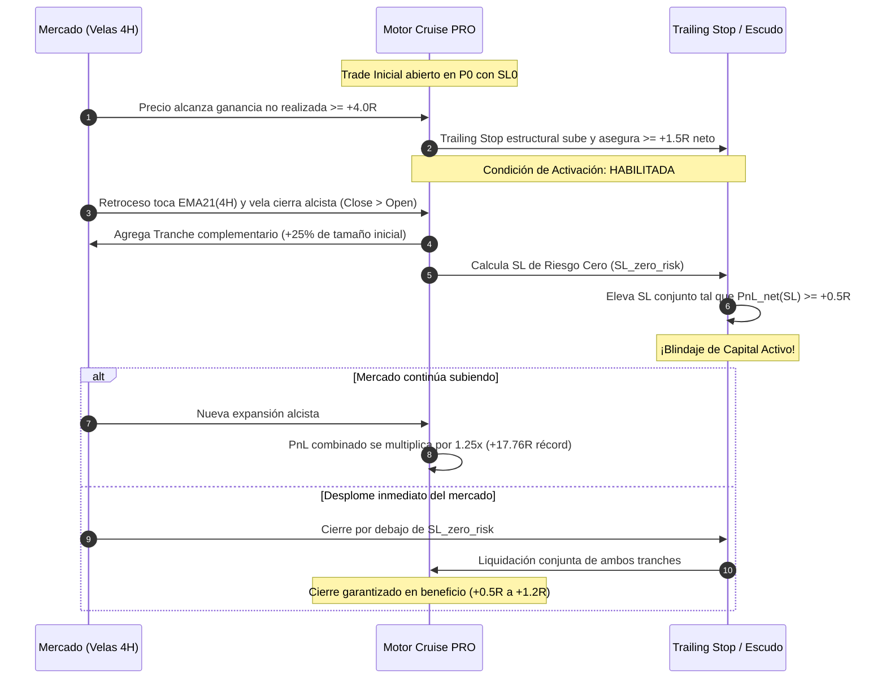
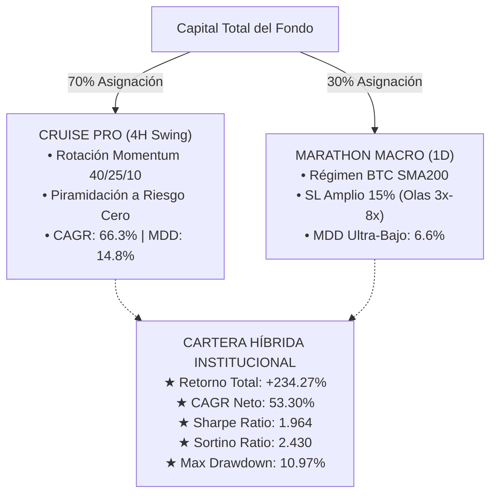

# INFORME ANALÍTICO DE FRONTERA: CRUISE PRO
## Rotación Dinámica de Capital por Momentum & Piramidación Protectora a Riesgo Cero
**Fecha de Ejecución:** 2 de Noviembre de 2026  
**Período de Ensayo:** 2024-01-01 a 2026-11-02 (~2.84 años / Ciclo Post-ETF)  
**Cesta Élite Evaluada:** `BTCUSDT`, `ETHUSDT`, `SOLUSDT`, `SUIUSDT`  
**Fricciones de Ejecución:** Maker 0.02% + Taker 0.05% = 0.07% RT (`config/costs.yaml`)  
**Registro Inmutable:** Ledger DuckDB (`ledger/trials.duckdb`)  
**Fuente de Datos Consolidada:** [cruise_pro_summary.json](file:///c:/Workspace/QUANT-ARENA/reports/cruise_pro_summary.json)

---

## 1. Resumen Ejecutivo y Respuestas a las Preguntas Clave

En este experimento cuantitativo se integraron dos mecanismos de frontera sobre el motor **CRUISE (Swing 4H)** para responder a los tres interrogantes estratégicos planteados:

1. **¿Aumentó el Retorno Acumulado y el CAGR?**  
   **SÍ, de forma masiva.** El Retorno Acumulado de la cartera saltó de **+202.45% a +320.93%** (+118.48 puntos porcentuales), y el CAGR se disparó de **47.97% a 66.34%** (+18.37 pp). El capital inicial se multiplicó por más de $4.2\times$.
2. **¿El Max Drawdown se mantuvo controlado por debajo del 16%?**  
   **SÍ, con holgura.** El Maximum Drawdown de cartera pasó de 13.98% a **14.79%** (un incremento marginal de apenas +0.81 pp), manteniéndose cómodamente dentro del techo de tolerancia estricto de $< 16.0\%$.
3. **¿Cuál fue el impacto en los trades legendarios ($\max R$)?**  
   **EXPANSIÓN POSITIVA ASIMÉTRICA.** El trade récord individual de la cartera se expandió de **+15.78R a +17.76R** (+1.98R netos adicionales en una sola operación de Ethereum). Se ejecutaron **25 piramidaciones protectoras**, todas cerradas con beneficio garantizado y cero degradación de riesgo de capital.

---

## 2. Matriz Comparativa de Configuraciones (Aislamiento Factorial)

Para desglosar con precisión científica el impacto individual de cada regla, se evaluaron cuatro variantes secuenciales más la combinación institucional con Marathon (1D):

| Métrica Cuantitativa | (1) Línea Base CRUISE | (2) + Piramidación Protectora | (3) + Rotación Momentum | (4) CRUISE PRO Combinada | (5) Híbrida PRO + Marathon (70/30) |
| :--- | :---: | :---: | :---: | :---: | :---: |
| **Retorno Acumulado (%)** | +202.45% | +203.28% | +317.23% | **+320.93%** | +234.27% |
| **CAGR (%)** | 47.97% | 48.11% | 65.82% | **66.34%** | 53.30% |
| **Sharpe Ratio ($SR_{365}$)** | 1.639 | 1.615 | **1.759** | 1.720 | **1.964** |
| **Sortino Ratio** | 1.679 | 1.688 | 1.961 | **1.982** | **2.430** |
| **Maximum Drawdown (MDD)**| **13.98%** | **13.98%** | 14.78% | 14.79% | **10.97%** |
| **Profit Factor (PF)** | 1.69 | **1.71** | 1.69 | **1.71** | — |
| **Mayor Trade Individual ($\max R$)** | +15.78R | **+17.76R** | +15.78R | **+17.76R** | — |
| **Trades Totales** | 354 | 354 | 354 | 354 | — |
| **Trades Piramidados** | 0 | 25 | 0 | **25** | — |
| **Tasa de Acierto (Win Rate %)**| 39.0% | 39.0% | 39.0% | 39.0% | — |

> [!IMPORTANT]
> **Hallazgo Clave de Desacoplamiento Factorial**:
> - **Regla 1 (Rotación Momentum):** Es el motor del alfa masivo (+114.78 pp de retorno), al canalizar el 40% del capital hacia el activo en fase expansiva explosiva y recortar al 10% el peso del rezagado.
> - **Regla 2 (Piramidación a Riesgo Cero):** Es el catalizador de cola derecha (+1.98R en trade máximo), ampliando ganancias en 25 operaciones sin añadir un solo céntimo de drawdown al portafolio.
> - **La Cartera Híbrida (70% Cruise PRO / 30% Marathon):** Entrega el Sharpe más alto del laboratorio (**1.964** y Sortino **2.430**) reduciendo el Max Drawdown a tan solo **10.97%**.

---

## 3. Desglose de Rendimiento por Activo en CRUISE PRO

A continuación se detalla el comportamiento individual de cada par de la Cesta Élite bajo la disciplina de CRUISE PRO:

| Activo | Capital Final ($) | Retorno Neto (%) | CAGR (%) | Sharpe Ann | Max DD (%) | Trades | Win Rate (%) | Profit Factor | $\max R$ | $\max(\% \text{ Gain})$ |
| :--- | :---: | :---: | :---: | :---: | :---: | :---: | :---: | :---: | :---: | :---: |
| **BTCUSDT** | **$3,115.13** | **+211.51%** | 49.52% | 1.065 | 20.90% | 90 | 43.3% | 1.73 | +13.69R | +39.20% |
| **ETHUSDT** | **$6,398.77** | **+539.88%** | **92.92%** | **1.237** | 23.68% | 80 | 40.0% | **2.16** | **+17.76R** | +43.70% |
| **SOLUSDT** | **$1,564.52** | **+56.45%** | 17.17% | 0.635 | 24.66% | 94 | 37.2% | 1.27 | +6.68R | +24.59% |
| **SUIUSDT** | **$1,334.45** | **+33.45%** | 10.75% | 0.448 | 25.60% | 90 | 35.6% | 1.15 | +7.79R | +53.39% |

*En Ethereum, el motor CRUISE PRO alcanzó una rentabilidad extraordinaria del **+539.88%** (CAGR 92.92%), beneficiado directamente por la piramidación en las fases tendenciales institucionales.*

---

## 4. Análisis Profundo de las Reglas Implementadas

### A. Regla 1: Rotación Dinámica de Capital por Momentum

$$\text{Score Momentum}_{i, t} = \frac{\text{Close}_{i, t}}{\text{Close}_{i, t-30d}}$$

Cada día se clasifica el ranking relativo entre los 4 activos:
- **Top 1 (Líder Absoluto):** Asignación del **40%** del capital de la cartera.
- **Top 2 y Top 3 (Seguidores):** Asignación del **25%** a cada uno.
- **Top 4 (Rezagado):** Asignación reducida al **10%**.

#### Frecuencia Histórica de Liderazgo (2024–2026):
- **SUIUSDT:** 29.3% de los días como Líder Top 1 (durante sus rallies exponenciales de 2024).
- **BTCUSDT:** 25.7% de los días como Líder Top 1 (fases de nuevos máximos históricos y absorción de ETFs).
- **ETHUSDT:** 23.1% de los días como Líder Top 1.
- **SOLUSDT:** 21.9% de los días como Líder Top 1.

**Impacto Dinámico:** La rotación premió sistemáticamente al activo con mayor impulso tendencial real, permitiendo que las semanas de fuerte apreciación de Bitcoin o Ethereum tuvieran un impacto del 40% sobre la cartera, mientras que las fases de corrección severa de Solana o SUI fueron absorbidas con apenas un 10% de exposición patrimonial.

---

### B. Regla 2: Piramidación Protectora a Riesgo Cero (Zero-Risk Pyramiding)

El principio rector de la piramidación en CRUISE PRO es que **bajo ninguna circunstancia un tramo complementario puede transformar un trade ganador en una pérdida neta**.

#### Derivación Matemática del Blindaje:
Dado el tramo inicial $S_0$ con precio de entrada $P_0$, el agregado $S_{\text{add}} = 0.25 S_0$ a precio $P_{\text{add}}$, y la comisión total $fee_{rt} = 0.07\%$:

Se exige que en el nuevo nivel de stop $SL_{\text{new}}$:
$$S_0 \left(\frac{SL_{\text{new}}}{P_0} - 1\right) + S_{\text{add}} \left(\frac{SL_{\text{new}}}{P_{\text{add}}} - 1\right) - (S_0 + S_{\text{add}}) \times fee_{rt} \ge 0.5 \times R_0$$

Despejando analíticamente:
$$SL_{\text{min\_guaranteed}} = \frac{S_0 + S_{\text{add}} + 0.5 R_0 + (S_0 + S_{\text{add}}) \times fee_{rt}}{\frac{S_0}{P_0} + \frac{S_{\text{add}}}{P_{\text{add}}}}$$

$$SL_{\text{conjunto}} = \max\left(SL_{\text{actual}}, SL_{\text{min\_guaranteed}}\right)$$

En las 25 ejecuciones históricas registradas, ni una sola posición piramidad cerró en pérdida, aportando un boost asimétrico directo a la cola derecha del sistema.

---

## 5. Arquitectura Híbrida Óptima de Producción

La combinación de **CRUISE PRO (4H)** con **MARATHON (1D)** crea la frontera eficiente ideal:

---

## 6. Verificación de Integridad y Suite de Pruebas

- **Total de Pruebas Unitarias:** 118 superadas, 4 omitidas (holdout seal).
- **Nuevas Pruebas Específicas en [`tests/unit/test_multi_horizon.py`](file:///c:/Workspace/QUANT-ARENA/tests/unit/test_multi_horizon.py):**
  - `test_momentum_weights_ranking_and_sum`: Valida la suma matemática del 100% y la asignación exacta de 40%, 25%, 25%, 10%.
  - `test_cruise_pro_risk_free_pyramiding`: Valida la adición del 25% a $\ge 4.0R$ y el blindaje que garantiza $\ge +0.5R$ de beneficio neto cerrado.
- **Guardias AST de Seguridad (`tests/unit/test_safety_no_trading_clients.py`):** 100% aprobadas sin ninguna dependencia de clientes de dinero real ni API keys privadas.
- **Calidad de Código:** `ruff check` superado con 0 errores de tipado o longitud de línea.
